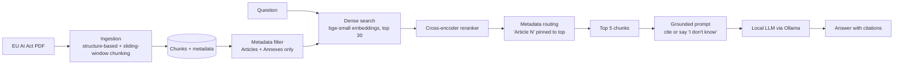

# AgentEval Arena

**A Retrieval-Augmented Generation (RAG) system over the EU AI Act, built from scratch with local open-source models - and evaluated step by step to show which techniques actually help.**

**Live demo:** _add your Hugging Face Space link here_ (retrieval demo; answer generation runs locally with Ollama)

Most RAG demos show that a chatbot *answers*. This project measures whether the system finds the *right evidence*, and shows with numbers which retrieval techniques improve it - and which do not.

- No LangChain or LlamaIndex: chunking, dense and keyword search, rank fusion, reranking, routing and evaluation are implemented in plain Python, so every design choice is visible and testable.
- Runs on a laptop (RTX 4050, 6 GB VRAM) with Ollama and open-source models - no API costs, no data leaves the machine.

**Result:** the correct article reaches the top 5 for **94%** of test questions (up from 72%), and the same local model goes from hallucinating legal citations to answering correctly with the right article.

---

## The project in plain words

1. **The problem:** AI chatbots answer confidently even when they don't know. Asked about the EU AI Act, a local model invented article numbers and fines.
2. **The fix (RAG):** before answering, the system *looks up* the relevant parts of the law and gives them to the model - an open-book exam instead of a closed-book one.
3. **The real question:** does the lookup find the right part of the law? I wrote a test set of questions where I know the correct article, and scored the search automatically.
4. **The improvements:** I tried search techniques one at a time and measured each against the same test, so every claim ("this helped") is backed by a number.
5. **Next (v2):** checking the answers themselves - correctness, grounding, and safety against tricky or malicious questions.

---

## Before and after

**Before** - the LLM asked about the Act **without** retrieval:

| Question | Model answer (no RAG) | Correct answer |
|---|---|---|
| Maximum fine for a prohibited AI practice? | "7% of turnover (Article 58)", plus invented 3% / 2% tiers | EUR 35M or 7% of turnover, whichever is higher (**Article 99**) |
| What does Article 4 require? | A long explanation of the Act's "scope" | **AI literacy** of staff (scope is Article 2) |

Fabricated article numbers and partial truths are the most dangerous failure mode, because they look verifiable.

**After** - same model, same questions, final pipeline:

| Question | Retrieved | Answer |
|---|---|---|
| Maximum fine for a prohibited AI practice? | Article **99** ranked 1st | "Up to EUR 35 000 000 or, if the offender is an undertaking, up to 7% of its total worldwide annual turnover for the preceding financial year, whichever is higher (Article 99)" - correct and cited |
| What does Article 4 require? | Article **4** ranked 1st | "...a sufficient level of AI literacy of their staff and other persons dealing with the operation and use of AI systems on their behalf..." (Article 4) - correct and cited |

---

## Architecture (final pipeline)



Also implemented and evaluated, but not in the final pipeline: **BM25** keyword search, **hybrid search** with Reciprocal Rank Fusion, and **HyDE**. See Results for why.

---

## RAG concepts implemented

| Stage | Technique | Why it matters |
|---|---|---|
| Ingestion | Structure-based chunking (one section per Article / Annex) | Every chunk carries its source article, enabling citations and automatic retrieval checks |
| Ingestion | Sliding window (800 chars, 100 overlap) | Sentences cut at a boundary still appear whole in the neighbouring chunk |
| Dense retrieval | Bi-encoder embeddings + cosine similarity (normalised dot product) | Matches meaning, even with different wording |
| Sparse retrieval | BM25 | Matches exact terms that embeddings can miss |
| Fusion | Reciprocal Rank Fusion (RRF) | Combines rankings without needing comparable scores |
| Query transformation | HyDE (Hypothetical Document Embeddings) | Searches with a fake answer, which can resemble real documents more than a short question does |
| Metadata filtering | Search Articles and Annexes only, not the preamble | The binding rules live in the articles; the recitals only explain them |
| Metadata routing | If a question names an article, pin that article | Identifiers like "Article 4" are invisible to embeddings |
| Post-retrieval | Cross-encoder reranking | Reads question and chunk together for higher precision, on a small shortlist for speed |
| Generation | Grounded prompt with mandatory citations and abstention | First line of defence against hallucination |
| Generation | Context isolation instruction | Instructions inside retrieved text are treated as data, not commands |

---

## Key concepts explained simply

**Chunking** - The law is about 600,000 characters long, far too much for a model to read at once, so it is cut into small pieces. I cut it at every Article and Annex, so each piece knows where it came from, and split long sections into 800-character pieces that overlap by 100 characters, so no sentence is lost at a cut.

**Embeddings** - A model turns each chunk into a list of numbers (a vector). Texts with similar meaning get similar numbers, even if they use different words. Searching means finding the chunks whose numbers are closest to the question's (cosine similarity).

**Grounded prompt** - The model is told: use only the retrieved text, cite the article for every claim, and say "I don't know" if the answer isn't there. When retrieval failed, the model said "I don't know" instead of inventing an answer.

**Golden set and metrics** - A list of questions with known correct articles, including questions the Act cannot answer. **Hit@k** asks "was the right article in the top k results?" **MRR** asks "how close to the top was it?" (rank 1 = 1.0, rank 2 = 0.5, rank 10 = 0.1).

**HyDE** - Questions are short and casual; laws are long and formal. HyDE asks the LLM to first write a *fake answer in the style of the law*, then searches with that instead of the question. The fake answer is only a search key and is never shown to the user. It costs one extra LLM call per question, and it works best when the LLM already knows the subject well.

**BM25 (keyword search)** - Scores chunks by matching exact words, giving more weight to rare words.

**Hybrid search and RRF** - Runs embedding search and keyword search together and merges the two ranked lists: each chunk gets `1 / (60 + rank)` points from each list, so chunks ranked high in both win.

**Metadata filtering and routing** - Using the labels attached to each chunk: *filtering* restricts the search to certain sections; *routing* jumps straight to an article the question names.

**Reranking** - A second, more careful model (a cross-encoder) reads the question together with each of the top 30 candidates and reorders them. Too slow to run on every chunk, so it only re-sorts the shortlist.

---

## Evaluation method

- **Golden set:** 20 hand-written questions, each labelled with the correct article and a reference answer; 18 answerable and 2 deliberately unanswerable.
- **Retrieval metrics:** Hit@1, Hit@3, Hit@5, Hit@10 and MRR, at article level, for every retrieval method on the same questions.
- **One change at a time:** each technique was added separately and measured against the previous best, so its effect can be attributed.
- Retrieval is evaluated separately from generation, because if the right chunk is not retrieved, no prompt can save the answer.

---

## Results

### Retrieval (18 answerable golden questions)

| Method | Hit@1 | Hit@3 | Hit@5 | Hit@10 | MRR |
|---|---|---|---|---|---|
| dense (baseline) | 0.44 | 0.67 | 0.72 | 0.83 | 0.57 |
| dense + annex chunking fix | 0.44 | 0.67 | 0.72 | 0.83 | 0.57 |
| HyDE | 0.33 | 0.61 | 0.72 | 0.72 | 0.50 |
| BM25 (keyword only) | 0.17 | 0.33 | 0.50 | 0.67 | 0.30 |
| hybrid (dense + BM25, RRF) | 0.33 | 0.61 | 0.72 | 0.83 | 0.51 |
| dense, preamble filtered | 0.72 | 0.78 | 0.83 | 0.89 | 0.77 |
| hybrid, preamble filtered | 0.67 | 0.72 | 0.83 | 0.83 | 0.72 |
| dense filtered + metadata routing | **0.78** | 0.83 | 0.89 | **0.94** | **0.83** |
| dense filtered + cross-encoder rerank | 0.61 | **0.89** | **0.94** | **0.94** | 0.75 |
| **full: filtered + rerank + routing (final)** | 0.61 | **0.89** | **0.94** | **0.94** | 0.75 |

**Summary:** Hit@5 rose from **0.72 to 0.94** and MRR from **0.57 to 0.75-0.83**. With 18 questions, one question = 0.056, so small differences between the last three rows are within noise; the jump from the baseline is not.

### Key findings

**1. Most failures were retrieval failures, not LLM failures.** In the dense baseline, "What does Article 4 require?" ranked the correct chunk 31st and the fine question ranked Article 99 11th. In both cases the grounded prompt answered "I don't know" instead of hallucinating, which isolated the problem to retrieval.

**2. The biggest gain came from data, not models.** Excluding the preamble from search improved Hit@1 from 0.44 to 0.72, more than any retrieval algorithm. The 180 recitals explain the rules in everyday language, so they matched questions better than the binding articles did. (Caveat: the golden set labels articles as correct, which favours this filter; for a compliance tool that must cite binding rules, that is the right target.)

**3. A rule beat every model on identifiers.** "Article 4" was never found by dense, BM25, hybrid or HyDE, because embeddings ignore labels and "article" and "4" are common words. One line of metadata routing fixed it.

**4. A correct fix doesn't always move the metric.** The 13 Annexes had been silently merged into Article 113. Fixing the chunking corrected the data (Article 113 went from dozens of chunks to its real 2), but the scores did not change, which revealed a second cause: many other passages also discuss dates of application.

**5. HyDE gave mixed results and no net gain.** It moved the Article 99 fine question from rank 9 to 2, but hurt deepfakes (3 -> 17), emotion recognition (16 -> 40), social scoring (6 -> 12) and Article 4 (31 -> not found). HyDE relies on the LLM's own knowledge of the domain, and the first experiment had already shown this 4B model's knowledge of the Act is weak. Not kept.

**6. Keyword search struggles with legal vocabulary, so hybrid search was not automatically better.** People ask about "chatbots" and "deepfakes"; Article 50 says "AI systems intended to interact directly with natural persons" and "deep fake" (two words). BM25 alone reached only 0.50 Hit@5, and fusing it at equal weight with dense search lowered MRR (0.57 -> 0.51). Hybrid search is a common default, but whether it helps depends on how much users' words overlap with the document's.

**7. Reranking trades #1 precision for top-5 recall.** The cross-encoder brought the correct article into the top 5 for 17 of 18 questions (0.94), but put it first less often (0.61 vs 0.72). Since the LLM reads all five chunks, Hit@5 matters most, so reranking stays. If only the top result mattered, or latency were critical, filtered dense + routing would be the better choice.

---

## Build log

| Step | What I did | What I learned |
|---|---|---|
| 1 | Asked the LLM about the Act **without** retrieval | It invented article numbers and fines - confident hallucination |
| 2 | Parsed the PDF and chunked it by Article with a sliding window | Structure-based chunks carry metadata, enabling citations and automatic scoring |
| 3 | Embedded all chunks and built dense search + a grounded prompt | Hallucinations stopped (the model said "I don't know"), but the right chunks were often missing |
| 4 | Checked where the correct chunk ranked | Article 4 ranked 31st: the failure was in **retrieval**, not the LLM |
| 5 | Built a golden set and measured the dense baseline | Hit@5 = 0.72, MRR = 0.57 |
| 6 | Fixed chunking so the 13 Annexes are separate sections | Data became correct, but scores did not move - measuring revealed a second cause |
| 7 | HyDE | No net gain at the cost of an extra LLM call; dropped |
| 8 | BM25, then hybrid search with RRF | BM25 weak on legal wording; hybrid matched dense at Hit@5 but lowered MRR |
| 9 | Metadata filtering (no preamble) | **Biggest single gain**: Hit@1 0.44 -> 0.72 |
| 10 | Metadata routing for "Article N" | Fixed the identifier problem; best Hit@1 (0.78) and MRR (0.83) |
| 11 | Cross-encoder reranking | Best Hit@5 (0.94), fewer #1 hits |
| 12 | Final pipeline + answer generation + Streamlit app | Both original hallucination questions now answered correctly with the right citation |

---

## Project structure

```
agenteval-arena/
├── data/
│   ├── eu_ai_act.pdf          # Regulation (EU) 2024/1689 (public EU legislation)
│   ├── chunks.json            # generated by rag/ingest.py
│   ├── embeddings.npy         # generated dense index
│   └── golden_set.json        # hand-labelled evaluation questions
├── rag/
│   ├── step01_no_rag.py       # the LLM without retrieval (the "before")
│   ├── ingest.py              # PDF -> chunks with metadata
│   ├── retrieve.py            # dense, BM25, hybrid, HyDE, filtering, routing, rerank
│   ├── generate.py            # grounded answer generation
│   └── check.py               # rank diagnostics for single questions
├── arena/
│   ├── metrics.py             # Hit@k, MRR
│   └── run_eval.py            # evaluates any retrieval method on the golden set
├── results/
│   └── retrieval_results.csv  # results table used by the app
├── app.py                     # Streamlit demo and results dashboard
├── pyproject.toml / uv.lock   # dependencies
└── README.md
```

---

## Tech stack

| Component | Choice | Reason |
|---|---|---|
| LLM | Qwen3-4B via **Ollama** | Runs locally on a 6 GB GPU, no API cost |
| Embeddings | `BAAI/bge-small-en-v1.5` (sentence-transformers) | Small, strong retrieval model |
| Reranker | `cross-encoder/ms-marco-MiniLM-L-6-v2` | Fast cross-encoder |
| Vector search | **NumPy** (normalised dot product) | ~900 chunks need no vector database; keeps the maths explicit |
| Keyword search | `rank-bm25` | Standard BM25 implementation |
| PDF parsing | `pypdf` | Lightweight text extraction |
| UI | Streamlit | Interactive demo and results dashboard |
| Environment | `uv` | Fast, reproducible Python environments |

---

## How to run

**Prerequisites:** Python 3.12, [uv](https://docs.astral.sh/uv/), and [Ollama](https://ollama.com) for answer generation:

```bash
ollama pull qwen3:4b
```

**Setup:**

```bash
git clone <your-repo-url>
cd agenteval-arena
uv sync
```

**Run** (from the project root):

```bash
uv run python rag/ingest.py              # 1. chunk the PDF
uv run python rag/retrieve.py            # 2. build the embedding index
uv run python rag/generate.py            # 3. answer two example questions
uv run python arena/run_eval.py full     # 4. evaluate a retrieval method (dense, bm25, hybrid, hyde,
                                         #    dense_filtered, hybrid_filtered, routed, rerank, full)
uv run streamlit run app.py              # 5. demo + results dashboard
```

---

## Design decisions

- **Plain Python over frameworks** - to understand and control each stage; frameworks can be layered on later.
- **NumPy instead of a vector database** - with ~900 chunks, exact search is instant. A vector database (e.g. Qdrant with HNSW) becomes worthwhile at hundreds of thousands of chunks.
- **Article-level evaluation** - the golden set labels the correct *article*, so retrieval is scored automatically without labelling individual chunks.
- **Temperature 0 for answer generation** - makes outputs as repeatable as possible.
- **Graceful degradation** - if no LLM is available (as in the hosted demo), the app still runs and shows the retrieved sources.

## Limitations

- Small golden set: each question moves scores by about 5.6 percentage points.
- Answers are not yet evaluated systematically - only retrieval is (see Roadmap).
- The reranker was trained on web search, not legal text.
- PDF text extraction keeps page headers/footers in some chunks.
- The hosted demo shows retrieval only; answer generation needs a local Ollama model.

## Roadmap

- **v2 - answer evaluation:** LLM judges for correctness and groundedness, deterministic citation and abstention checks, and judge calibration against human labels
- **v2 - red-teaming:** prompt injection, poisoned documents, false premises, out-of-scope questions
- Expand the golden set to 50+ questions, including Annex questions
- Reranker score threshold instead of always sending 5 chunks
- Parent-child retrieval and contextual chunk headers
- CI quality gate: fail a pull request if evaluation scores drop

---

*Built as a hands-on study of RAG and retrieval evaluation. The EU AI Act is public EU legislation (Regulation (EU) 2024/1689).*
